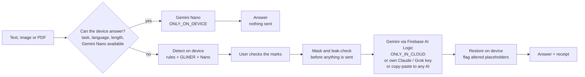

# Stand-In

**Use cloud AI on private text without handing over the private parts.**

People paste work email, contracts and health reports into chatbots every day, and those texts
carry names, phone numbers, ID numbers, account numbers and diagnoses. Stand-In sits between
the user and the cloud model, inside the browser:

1. **If the device can answer, nothing leaves it.** Short rewrite, shorten, translate and summarize
   tasks run on Gemini Nano through Firebase AI Logic hybrid inference.
2. **Otherwise the private details are found and masked on the device first.** Pattern rules, a
   small on-device PII model (GLiNER) and Gemini Nano mark names, contacts, IDs, accounts, dates of
   birth and more. The user checks the marks, then only text like
   `Ask [PERSON_1] to call [PHONE_1]` goes to the cloud.
3. **The reply is restored on the device.** Placeholders turn back into the real details locally.
   A placeholder the model altered is flagged, never guessed. A receipt shows exactly what left.

Live app: https://buildhybridai-2026-fdbba.web.app (English and Traditional Chinese UI)

## What makes it different

- **Local first, not mask-everything.** Redaction tools usually still send every request. Here the
  router keeps whatever the on-device model can handle on the device, and only the rest is masked.
- **Semantic detection on the device.** Fixed formats are easy; names, companies and medical
  conditions are not. GLiNER and Gemini Nano find those without any text leaving the browser.
- **The user stays in control.** Every mark can be removed, merged, split or added before sending.
- **Measured, not claimed.** Compared with Microsoft Presidio on held-out data (below), and an
  automated test intercepts every network request and fails if a marked original appears in any.

## How it works



- **Images and PDFs** are read on the device (Tesseract.js and pdf.js, with Gemini Nano as a
  fallback for noisy photos). The file itself is never uploaded.
- **Follow-up questions** reuse the same placeholder table, so `[PERSON_1]` stays the same person.
  The table lives only in the tab's memory and is gone when the tab closes.
- **Scenarios**: work email or document (short ones stay local), contract review and health-report
  explanation (always masked, larger cloud model; health shows a not-medical-advice notice).
- **Bring your own key or no key at all**: besides Gemini, Claude (Anthropic SDK) and Grok can be
  called with the user's own key, stored encrypted with a password (PBKDF2 + AES-GCM) in the
  browser. "Copy and paste to any AI" sends nothing from the app at all.

### Capability tiers

Every modern browser can use the app; what changes is how much happens on the device.

| Browser / device | Answer on device | Detection on device | Cloud |
|---|---|---|---|
| Desktop Chrome with Gemini Nano | Yes (English, Japanese, Spanish) | Rules + GLiNER + Gemini Nano | Masked text only |
| Other browsers with WebGPU (Edge, Safari 26, and others) | No | Rules + GLiNER (fp16) | Masked text only |
| Browsers without WebGPU | No | Rules + GLiNER (int8, slower) | Masked text only |
| Detection model not downloaded or failed | No | Rules + the user's own marks | Masked text only |

Tested so far: Chrome 157 on Windows with all three tiers (the lower tiers by switching layers
off), and Playwright's Firefox 157 build on Windows through the work-email scenario
(`tests/e2e/firefox-scenario1.mjs`). In Firefox the fp16 detection model fails to start on WebGPU,
so the app falls back to int8 on WASM; the flow completes and nothing marked is sent, but int8 is
weaker on Chinese names (in the Chinese sample it missed two names and marked one too widely, so
the user has to fix those on the confirm screen). Safari and phones have not been tested on real
devices yet; the app picks the tier from what the browser reports, and falls back to the
rules-only tier if the detection model fails to load.

### Firebase products used

| Product | Use |
|---|---|
| Firebase AI Logic | Hybrid inference: Gemini Nano on the device (`ONLY_ON_DEVICE`, download via `initializeDeviceModel`) and Gemini in the cloud (`ONLY_IN_CLOUD`) for masked text |
| App Check (reCAPTCHA Enterprise) | Protects the AI Logic endpoint |
| Remote Config | Cloud model names, local-route length limit, detection chunk sizes, the Nano Chinese-detection switch, per-scenario prompts |
| Authentication (anonymous) | Identifies the writer of a receipt |
| Firestore | Receipts with **statistics only** (counts per type, route, latency). Security rules reject any other field and every read |
| Hosting | The app, with cross-origin isolation headers for the on-device models |

## Evaluation

Full method, caveats and per-type tables: [`eval/README.md`](eval/README.md); results:
[`eval/report.md`](eval/report.md). Baseline: Microsoft Presidio with spaCy large models.
"Overlap F1" counts a detail as found when the mask touches it; "structured recall" covers
email, phone, ID, card and account numbers.

| Data | Ours (rules + GLiNER) overlap F1 | Presidio overlap F1 | Ours structured recall | Presidio structured recall |
|---|---|---|---|---|
| English: NVIDIA Nemotron-PII test split, 299 documents | **92.4%** | 83.8% | **96.7%** | 86.9% |
| Traditional Chinese: 30 synthetic texts | **89.7%** | 72.4% | **100%** | 64.3% |
| Traditional Chinese read from 10 images and PDFs | **78.9%** | 60.5% | **100%** | 70.0% |

Limits, stated plainly: the engine was tuned on a separate dev sample, but the Chinese sets have no
dev split and one Chinese rule was added after seeing the first Chinese run, so the Chinese numbers
are optimistic. All data is synthetic. OCR misread 6 of 35 details in the Chinese photo and scan
samples (mostly names), which is why the app asks the user to check text read from images.
Coverage against the HIPAA Safe Harbor identifiers and Taiwan's Personal Data Protection Act,
including what is **not** covered, is listed in `eval/README.md`.

## Testing instructions for judges

**Quickest path (any browser, no downloads):**
1. Open https://buildhybridai-2026-fdbba.web.app.
2. Choose the scenario "Contract" and paste a short text with a name, an email and a phone number,
   for example: `Please review: Priya Raman (priya.raman@consult-demo.io, +44 20 7946 0958) will be paid $48,000.`
3. Press "Find private details". Without the detection model only fixed formats are marked; select
   the name in the "Mark something the detector missed" box and mark it.
4. Press "Send masked text", then open the receipt under the answer to see exactly what was sent.

**Full experience (desktop Chrome):**
- Developed and tested on Chrome 157 on Windows 11. Gemini Nano needs, per Chrome's documentation,
  Windows 10/11, macOS 13+, Linux or a Chromebook Plus; at least 22 GB free disk space; and either a
  GPU with more than 4 GB of VRAM or 16 GB of RAM with 4 CPU cores. It is not available on mobile.
- In the status bar press "Prepare on-device model" (Gemini Nano, about 4 GB, one-time download on
  an unmetered connection) and "Download" for the detection model (580 MB with WebGPU, 349 MB
  without, one-time).
- Try a short English email with the task "Rewrite": it runs on the device and sends nothing.
  Then try the same text with "Analyze / explain": details are marked, masked and sent.
- To check the privacy claim yourself, keep DevTools' Network panel open and search request
  payloads for any marked name.

**Also worth trying:** add an image or PDF; ask a follow-up question; switch the UI to 中文; choose
"Copy and paste to any AI" to use any chatbot without the app sending anything.

## Run it yourself

```
npm install
npm run dev          # http://localhost:5173
npm test             # unit tests
npm run test:privacy # network-interception privacy test (needs Java 21 and installed Chrome)
```

Cloud calls need a Firebase project of your own; see `src/config/firebase.ts`. For local
development, put an App Check debug token in `.env.local` as `VITE_APPCHECK_DEBUG_TOKEN`.

## Repository map

| Path | What |
|---|---|
| `src/detect/` | Detection engine: rules, GLiNER layer, Gemini Nano layer, exact-search location, merging, entity grouping |
| `src/relay/` | Routing, masking, leak check, restore, follow-up placeholder reuse |
| `src/extract/` | Image and PDF text extraction on the device |
| `src/vault/` | Encrypted key vault for bring-your-own-key providers |
| `src/services/` | Firebase AI Logic, providers, Remote Config, receipts |
| `tests/e2e/` | Privacy test, file-input test, live scenario runs |
| `eval/` | Evaluation against Presidio |
| `docs/prototype-findings.md` | Platform measurements that shaped the design |

## License

Apache-2.0. All test data is synthetic; any resemblance to real people is coincidental.
